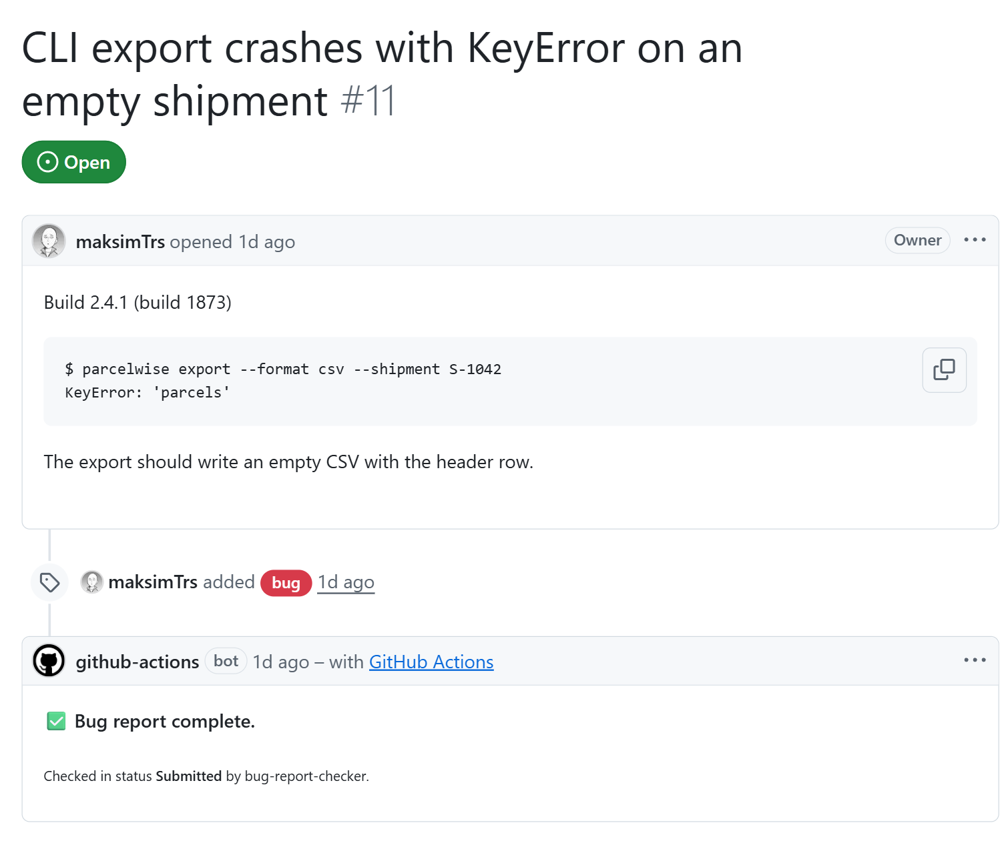
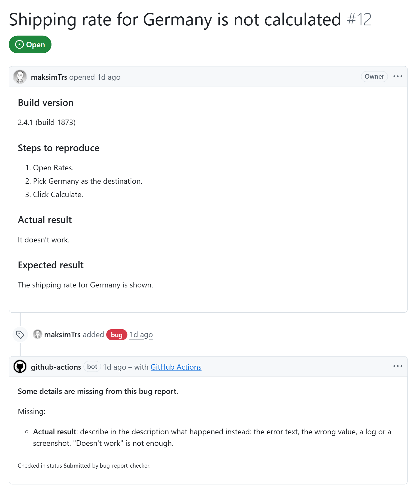
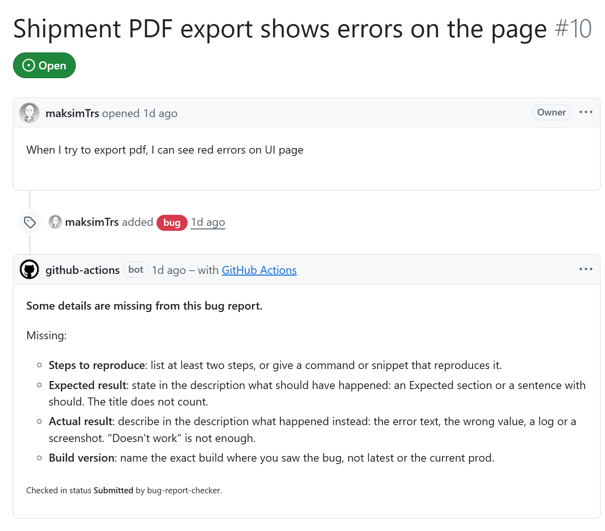

# bug-report-checker sandbox

**A bot that reads a new bug report and says what is missing before anyone starts on it**: steps to reproduce, expected result, actual result, build version. This repository is its live demo. Open a bug and its comment appears in about a minute. All issues here are made up.

> [!NOTE]
> The bot itself is the GitHub Action [**maksimTrs/bug-report-checker**](https://github.com/maksimTrs/bug-report-checker). This repo only connects it, in [`.github/workflows/bug-checker.yml`](.github/workflows/bug-checker.yml).
>
> - **What it is:** decisions come from a small [Laya](https://github.com/NandhaKishorM/laya) model fine-tuned on public Jira bug reports ([ippo123/bug-report-checker](https://huggingface.co/ippo123/bug-report-checker)). Plain rules run on top of it.
> - **Why a model like this:** it runs on a free CPU runner, with no LLM API and no keys. A check takes 30–45 s.
> - **Where to look:** the code is in [`src/bug_report_checker/`](https://github.com/maksimTrs/bug-report-checker/tree/main/src/bug_report_checker). The architecture diagram is in its [README](https://github.com/maksimTrs/bug-report-checker#readme), and the metrics are in [`docs/results.md`](https://github.com/maksimTrs/bug-report-checker/blob/main/docs/results.md).

## What the bot answers

| Report | Bot's verdict |
|---|---|
| [#11](https://github.com/maksimTrs/bug-report-checker-sandbox/issues/11): build, a command with its error, what should happen | ✅ complete |
| [#12](https://github.com/maksimTrs/bug-report-checker-sandbox/issues/12): the template filled in, but Actual says only "It doesn't work." | missing: actual result |
| [#10](https://github.com/maksimTrs/bug-report-checker-sandbox/issues/10): a clear title and one vague line | missing: steps, expected, actual, build |

<b>#11: a complete report</b>

 
<picture>
  <source media="(prefers-color-scheme: dark)" srcset="docs/screenshots/11-complete-dark.png">
  
</picture>

<b>#12: a filled-in template that still says nothing</b>

 
<picture>
  <source media="(prefers-color-scheme: dark)" srcset="docs/screenshots/12-vague-actual-dark.png">
  
</picture>

<b>#10: a title and one line</b>

 
<picture>
  <source media="(prefers-color-scheme: dark)" srcset="docs/screenshots/10-missing-all-dark.png">
  
</picture>

The bot runs in **strict mode** here (`strict: true` in [`.github/bug-checker.yml`](.github/bug-checker.yml)). Expected and actual results must be written out in the description, and "doesn't work" does not count. When the author edits the report, the bot updates its own comment instead of posting a new one.

**Try it:** [open a bug](https://github.com/maksimTrs/bug-report-checker-sandbox/issues/new?template=bug.yml) with the form.

## How this repo is set up

- [`.github/workflows/bug-checker.yml`](.github/workflows/bug-checker.yml): the bot on issue events, pinned to a commit of the Action.
- [`.github/bug-checker.yml`](.github/bug-checker.yml): its settings. Statuses are the labels `Submitted`, `Open` and `In Progress`; an open bug without one counts as `Submitted`. The test stands are `staging` and `qa1`.
- [`.github/ISSUE_TEMPLATE/bug.yml`](.github/ISSUE_TEMPLATE/bug.yml): the bug form.

## End-to-end tests

Each scenario in [`tests/test_scenarios.py`](tests/test_scenarios.py) is a made-up report plus the exact verdict the bot must give: complete, or which parts are missing, plus its hints and the environment it must name. The 11 scenarios cover empty sections, a single line, a bare stack trace, screenshot-only results, `current prod` as the build, a bug filed straight into `In Progress`, and a closed bug that the bot must leave alone.

A run opens real issues with the `e2e` label, waits for the bot's comment and closes each issue at the end. The scenarios run in parallel (pytest-xdist), so a run takes about two minutes. The Job Summary lists every scenario with its issue and the expected and actual verdicts.

CI ([`.github/workflows/e2e.yml`](.github/workflows/e2e.yml)) runs on demand, weekly, and on changes to the tests or the bot's setup. The `E2E_TOKEN` secret is a fine-grained PAT for this repo with Issues read and write. Issues opened with the workflow's own `GITHUB_TOKEN` start no workflows, so the bot would never see them.

To run locally, use `uv run pytest -n 12` after `gh auth login`, or set a token in `E2E_TOKEN`. `uv run pytest -m "not e2e"` runs only the offline tests of the client.

## Limits

- English reports only, and a fixed rubric: four blockers plus hints on the title.
- "Concrete actual result" is the weakest check. In strict mode the bot catches about half of the vague ones, 15 of 30 on the [strict test set](https://github.com/maksimTrs/bug-report-checker#results).
- A question in the Expected section ("Shouldn't the newest be on top?") passes as an expected result: [#14](https://github.com/maksimTrs/bug-report-checker-sandbox/issues/14).

## Data attribution

The model is trained on a public dataset and synthetic examples.

Data: The Public Jira Dataset — Montgomery L., Lüders C., Maalej W. *An Alternative Issue Tracking Dataset of Public Jira Repositories.* MSR 2022. DOI: [10.1145/3524842.3528486](https://doi.org/10.1145/3524842.3528486). Dataset: https://doi.org/10.5281/zenodo.5882881. License: [CC BY 4.0](https://creativecommons.org/licenses/by/4.0/).
